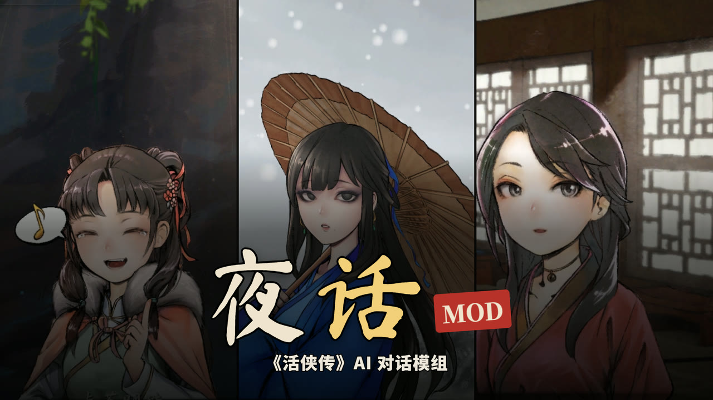
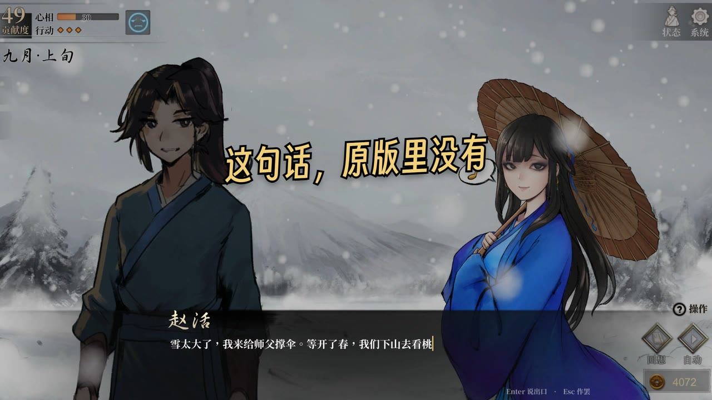
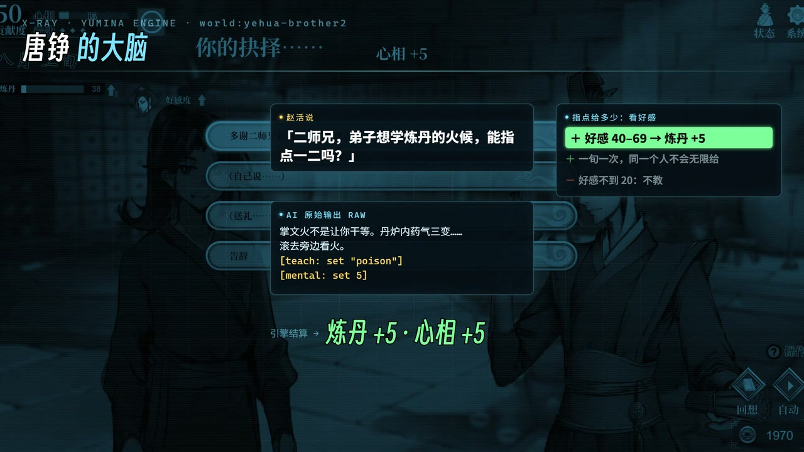
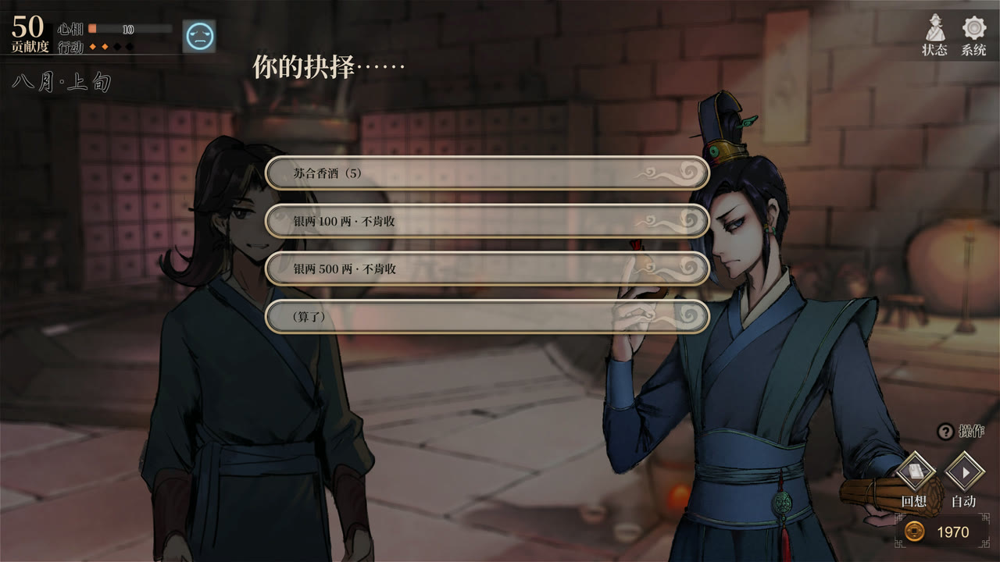
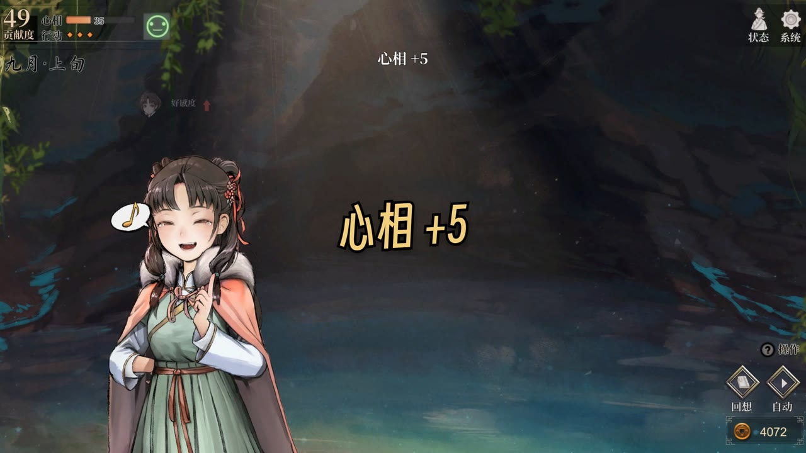

# 江湖夜话 ·《活侠传》AI 对话模组

<b>简体中文</b> · <a href="#한국어">한국어</a> · <a href="#english">English</a>

在《活侠传》里，和唐门的人、崖底的叶云裳、雪山上的师父坐下来，聊点剧情里没写的话。她们用原版的对话框、立绘和表情回你。

- 唐门地图上多了「夜话」，门里的人都能找来聊。
- 剧情里每次歇脚都能聊：崖底、雪山、崆峒的自由时间。
- 送礼看各人喜好，不合心意的当面退回；讨教武学、炼丹会真的加。
- 她记得你们之间的事，过几旬再去，还提得起。
- 有免费游玩的选项，不用自己找 Key；也可以用自己的 DeepSeek / OpenRouter / Kimi 等 Key。

| | |
|---|---|
|  自己打字，她用原版的对话框、立绘和表情回你 |  讨教真的会加：AI 只管说话，数值由规则结算 |
|  送礼看各人喜好，不肯收的会标出来 |  剧情里歇脚时也能聊：崖底、雪山、崆峒 |

**[下载最新版 →](https://github.com/Cpjjason/jianghu-yehua/releases/latest)**（下载 `JianghuYehua_v*.zip`）

## 安装

**最省事：一键安装**

1. 把压缩包解压到任意位置（右键 → 全部解压缩）。
2. 双击解压出来的 **「点我安装.bat」**。它会自己找到《活侠传》的游戏文件夹（Steam 库、或者你解压到的上一层），把需要的东西拷进去，最后显示「装好了！」。
   - 弹出 Windows 安全提示时点「运行」（或「更多信息」→「仍要运行」）。
   - 找不到游戏时会弹窗让你选游戏文件夹（里面有 `Mortal.exe` 的那个）。
3. **正常启动游戏**。进到唐门地图，右上角「储存」左边多了「夜话」按钮，就装好了。
4. **第一次点「夜话」会打开设置**：
   - 不想找 Key，想免费玩：点设置页最上面金色的 **「没有 API Key？点这里免费玩」**，浏览器里注册或登录后点「允许」，游戏会自己连上。
   - 用自己的 Key：服务商默认 DeepSeek（也能选 OpenRouter / Kimi 等），粘贴 API Key，点「测试连接」，显示「连上了」就能聊。Key 只存在你电脑上，只发给你选的服务商。

**手动安装**

1. Steam 库里右键《活侠传》→ 管理 → 浏览本地文件，打开有 `Mortal.exe` 的文件夹。
2. 把压缩包里的东西全部解压进去。解压完，`Mortal.exe` 旁边应该多出 `BepInEx` 文件夹、`winhttp.dll`、`doorstop_config.ini`、`.doorstop_version`。
   - 如果多了一层文件夹：双击那层文件夹里的「点我安装.bat」，或者把里面的东西拿出来和 `Mortal.exe` 放在一起。
   - 已经装过 BepInEx 6 的：只把 `BepInEx\plugins\MortalTalk` 拷过去就行。

压缩包里也有一份 `安装说明.txt`。

## 装不上？

- **地图上没出现「夜话」**：看看 `winhttp.dll` 是不是和 `Mortal.exe` 在同一个文件夹。有的杀毒软件会删掉它，把游戏文件夹加进白名单后重新解压。
- **和别的 mod 一起用**：别的 mod 也是 BepInEx 6 的就没问题；用 BepInEx 5 的 mod 不能共存。
- **游戏更新后失效**：等新版本，模组的设置页会提示「有新版本」。目前适配的游戏版本：1.0.6000.5。

## 卸载

删掉 `BepInEx\plugins\MortalTalk` 文件夹。连 BepInEx 也不要了：再删 `BepInEx` 文件夹、`winhttp.dll`、`doorstop_config.ini`、`.doorstop_version`。

## 隐私

你和角色说的话、以及这段对话需要的游戏状态（好感、时间、人物信息），会发给你在设置里选的服务商生成回复：用自己的 Key 时只发给那个服务商，选 Yumina 时发给 Yumina，别的地方都不发。夜话的记忆存在本机 `BepInEx\config\JianghuYehua\`。

## 开源组件

BepInEx 6（LGPL-2.1）· Jint（BSD-2-Clause）· Acornima（BSD-3-Clause）· Newtonsoft.Json（MIT）。由 Yumina 引擎驱动。

---

## 한국어

**강호야화**는 《활협전》 AI 대화 모드예요. 당문 사람들, 절벽 아래의 엽운상, 설산의 사부와 마주 앉아 원작에 없는 이야기를 나눌 수 있고, 상대는 원작의 대화창·일러스트·표정 그대로 대답해요.

- 지도에 「야화」 버튼이 생기고, 당문 사람이라면 누구에게든 말을 걸 수 있어요.
- 스토리 중 쉬어 가는 때에도 대화할 수 있어요: 절벽 아래, 설산, 공동파 자유 시간.
- 선물은 각자 취향대로 받고, 마음에 안 들면 그 자리에서 돌려줘요. 무공·연단 가르침을 받으면 수치가 실제로 올라요.
- 함께한 일을 기억해서, 몇 순이 지나 다시 찾아가도 꺼내요.
- 게임 언어를 한국어로 해 두면 메뉴와 대화가 한국어로 나와요.
- 본인 API 키(DeepSeek / OpenRouter / Kimi 등)를 연결할 수 있고, 키가 없으면 Yumina에 로그인해서 무료 이용량을 받을 수 있어요.

**[최신 버전 다운로드 →](https://github.com/Cpjjason/jianghu-yehua/releases/latest)** (`JianghuYehua_v*.zip`)

### 설치

1. 압축 파일을 아무 곳에나 풀어요 (오른쪽 클릭 → 압축 풀기).
2. 풀린 폴더의 <b>「点我安装.bat」</b>(설치 파일)를 더블클릭하면, Steam 라이브러리에서 게임 폴더를 찾아 자동으로 설치하고 「설치 완료!」를 보여 줘요.
   - Windows 보안 경고가 뜨면 「추가 정보」 → 「실행」을 누르세요.
   - 직접 설치하려면: Steam에서 《활협전》 오른쪽 클릭 → 관리 → 로컬 파일 보기, 압축 파일 안의 내용을 `Mortal.exe` 옆에 모두 풀면 돼요.
3. 게임을 켜고 당문 지도로 가면 오른쪽 위에 「야화」 버튼이 생겨요.
4. 처음 「야화」를 누르면 설정이 열려요.
   - 키가 없으면: 맨 위 금색 칸 <b>「API 키가 없나요? 여기서 무료로 플레이」</b>를 누르고, 브라우저에서 가입/로그인한 뒤 「허용」을 누르면 게임이 자동으로 연결돼요.
   - 본인 키: 제공처를 고르고 API 키를 붙여넣은 뒤 「연결 테스트」. 키는 내 컴퓨터에만 저장되고, 고른 제공처에만 전송돼요.

문제가 있으면 [Issues](https://github.com/Cpjjason/jianghu-yehua/issues)에 남겨 주세요.

---

### English

**Jianghu Yehua** is an AI conversation mod for *Legend of Mortal*: sit down with anyone in the Tang Sect (and at the story's rest points) and type whatever you want to say; they answer in the game's own dialogue boxes, portraits and expressions, remember what you've shared, react to gifts by taste, and can really teach you skills.

Install: extract the release zip anywhere and double-click `点我安装.bat` (it finds the game through Steam and copies everything next to `Mortal.exe`), or extract it straight into the game folder; then start the game and press 「夜话」 on the map. Use your own API key (DeepSeek / OpenRouter / Kimi …) or press the gold **free** panel at the top of the settings (it switches to **Yumina**) to play for free without a key. UI languages: Simplified Chinese, Traditional Chinese, Korean.
